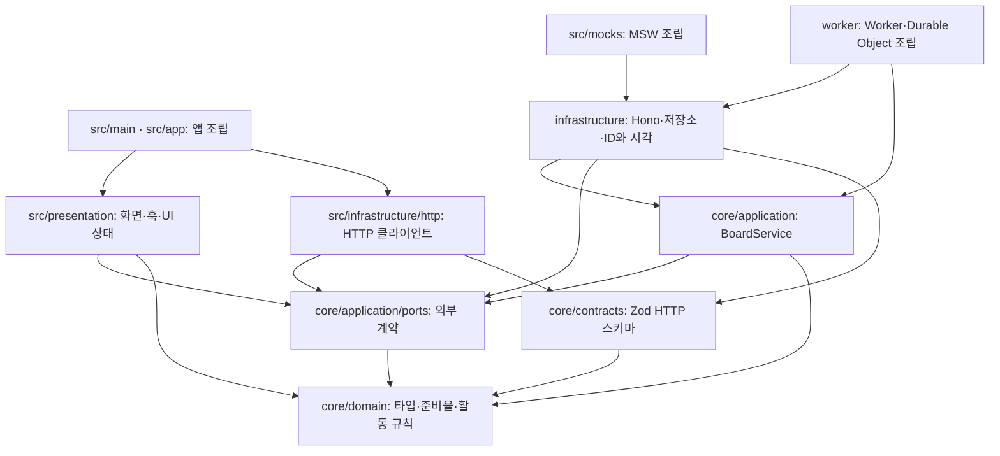

# 아키텍처와 기술 선택

핵심 원칙은 실행 환경과 화면이 바뀌어도 보드 처리 규칙과 HTTP 계약을 공유하는 것이다. 앱 조립, 표현, 포트, 응용 서비스, 저장소·HTTP 어댑터의 책임을 나누고 ESLint로 허용 의존 방향을 검사한다.

## 계층과 의존 방향

아래 화살표는 코드의 의존 방향이다. 조립 지점은 구현체를 생성해 포트에 주입한다.



- **도메인**: 보드·체크·활동 타입, 준비율과 분야 집계. 프레임워크·I/O·외부 패키지에 의존하지 않는다.
- **응용·포트**: `BoardService`는 조회·생성·완료·재개를 처리하고 저장소와 ID·시각 포트를 사용한다. 표현 계층과 HTTP 클라이언트는 `BoardGateway` 포트를 공유한다.
- **계약**: Zod 스키마가 입력과 HTTP 응답을 검증한다. 도메인 규칙과 HTTP 검증을 같은 책임으로 섞지 않는다.
- **공통 인프라**: Hono 라우팅·오류 매핑, 메모리 저장소, ID·시각 구현을 제공한다.
- **실행 환경**: MSW는 공통 API를 인터셉트에 연결하고, Worker는 같은 서비스를 영속 저장소에 연결한다. Worker가 `src/`를 import하지 않는다.
- **표현·앱 조립**: 화면은 주입된 포트를 사용한다. `src/main.tsx`가 HTTP 구현과 MSW 시작을 연결하고 `src/app/`이 Provider·라우터를 구성한다.

세부 의존 허용 목록은 `tooling/eslint/module-boundaries.mjs`에 있다. 같은 별칭을 공유해도 계층 밖의 구현체를 직접 가져올 수 있는 것은 아니다.

## 요청과 상태의 흐름

```text
화면 → Query 훅 → 주입된 BoardGateway → HTTP 클라이언트 → fetch
                                                        ↓
                              MSW → 공통 Hono API → BoardService → 메모리 저장소

로컬 Worker 요청 → Worker 라우터 → Durable Object → 같은 Hono API·서비스 → 영속 저장소
```

두 실행 환경은 계약·서비스를 공유하지만 데이터는 공유하지 않는다. 프런트엔드 기본 동작은 MSW이며 로컬 Worker와 자동 연결되지 않는다.

- TanStack Query는 서버 보드와 조회 갱신을 소유한다. 변경은 성공 응답 뒤에 반영하고 실패 시 기존 상태를 유지한다.
- Zustand는 선택 분야만 소유한다. 보드 데이터를 중복 보관하지 않는다.
- 대화상자 열림·입력·검증은 해당 컴포넌트와 훅의 로컬 상태다.
- 메모리·Durable Object 저장소는 조회·변경을 직렬화하고 초안을 격리한다. 저장이 실패해도 다음 요청을 처리할 수 있다.

API 상태 코드·오류 형식·직렬화 계약은 [코어 설계](CORE_ARCHITECTURE.md)에, 화면 조합·상태·접근성은 [표현 계층 설계](PRESENTATION_ARCHITECTURE.md)에 정리한다.

## UI와 경로

View·페이지·영역 조립은 역할이 드러나는 컴포넌트로 구성한다. HTML·스타일은 명명된 레이아웃과 말단 컴포넌트에 둔다. 직접 작성한 컴포넌트는 한 파일에 하나씩 두며 테이블 계열·`br`을 사용하지 않는다.

shadcn CLI에서 가져온 UI 원본은 `src/presentation/ui`에 둔다. 파일 분리·선언 규칙의 예외를 기능 컴포넌트로 넓히지 않는다. 세부 컨벤션은 [React 스킬](../.agents/skills/react-conventions/SKILL.md)을 따른다.

HashRouter가 정적 호스팅의 경로 새로고침을 처리한다. Vite의 `BASE_PATH`가 asset·MSW 파일·클라이언트 API 경로를 결정하며 Pages에서는 `/excheck/`다. 경로 별칭의 단일 기준은 `tsconfig.paths.json`이며 Vite·Vitest·TypeScript·Wrangler에서 공유한다.

## 기술 선택

- **React·TypeScript·Vite·Tailwind CSS**: 화면, 정적 타입, 개발·번들, 테마와 반응형 스타일
- **shadcn/ui·Radix**: Dialog·Sheet·Tabs·Select·Checkbox·Chart 등의 원본 UI와 상호작용
- **Recharts·GSAP**: 실제 체크 기반 차트와 진입·숫자·체크 모션. 모션 축소 설정을 반영한다.
- **TanStack Query·Zustand**: 서버 상태와 일시적 분야 필터를 분리
- **Hono·Zod·MSW**: 공통 HTTP API·스키마·브라우저 모의 처리
- **Workers·Durable Object**: 로컬 검증용 실행 환경과 영속 저장소
- **Vitest·React Testing Library·Playwright·axe**: 도메인부터 브라우저까지 검증
- **pnpm·ESLint·Prettier**: lockfile, 계층·코드 규칙과 일관된 포맷

Vite가 `.env` 형식을 직접 읽으므로 dotenv 패키지는 추가하지 않았다. Node 24, TypeScript 6.0.3·ESLint 10 등의 버전 선택과 자동 검사 한계는 [품질 문서](QUALITY.md#버전-선택)를 따른다. 정확한 설치 버전은 `pnpm-lock.yaml`이 기준이다.

## 배포와 한계

GitHub Pages는 MSW 데모만 배포한다. 서비스 워커는 HTTPS 또는 localhost를 필요로 하며 React 렌더링 전에 시작한다. 상태는 페이지 새로고침 시 초기화된다.

Worker 원격 배포나 실제 Cloudflare 계정 연결은 하지 않는다. Worker API는 `/api/`이므로 프런트엔드의 mock 해제만으로 별도 출처 서버에 연결되지 않는다. 운영 연결에는 API 주소·인증·사용자 격리·제한·저장 마이그레이션 등을 별도 설계해야 한다.

인증·페이지네이션·삭제·다중 프로젝트는 구현 범위 밖이다. 실제 운영 플랫폼의 동작을 로컬 workerd 결과로 보장하지 않는다. 리뷰·배포 권한과 되돌리기는 [작업 절차](WORKFLOW.md)를 따른다.
