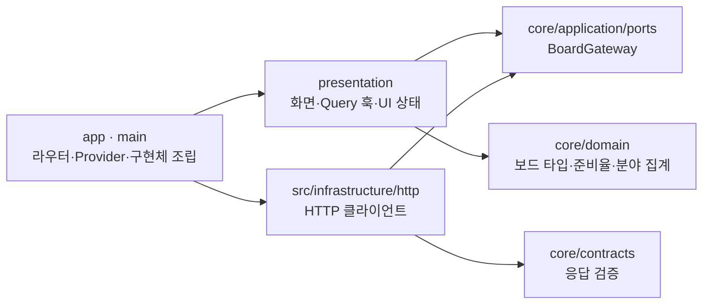

# 한국어 출시 관제 화면

기존 생성·완료·재개·분야 필터·세 경로·새로고침 초기화를 유지하면서, 공통 코어 위에 표현 계층과 앱 조립 지점을 분리한다. 인증·삭제·새로운 저장 방식이나 실제 Cloudflare 연결은 범위 밖이다. 전면 정비의 구현 근거는 [PR #7](https://github.com/bboshi-lab/excheck/pull/7), 이후 품질 규칙은 [품질 문서](QUALITY.md)를 참고한다.

## 책임과 의존 방향



- `src/main.tsx`만 MSW 시작과 HTTP 클라이언트 생성을 연결한다. `app/`은 QueryClient·Gateway·Tooltip Provider와 라우트를 조립한다.
- `presentation/board/context`는 응용 포트 `BoardGateway`를 주입한다. Query 훅이나 컴포넌트가 HTTP 클라이언트 구현을 import하지 않는다. 테스트도 같은 Provider에 검증할 구현체를 주입한다.
- `presentation/board/api`는 서버 상태의 조회·변경·성공 후 캐시 무효화를 담당한다. 서버 보드를 Zustand에 복제하지 않는다.
- `presentation/board/state`의 Zustand 저장소에는 선택한 분야만 둔다. 대화상자 열림과 입력값은 해당 컴포넌트의 로컬 상태다.
- `presentation/board/components`는 준비율·지표·차트·체크 목록·입력·활동 등 책임별 파일이다. `layout`은 공통 셸과 탐색, `pages`는 경로별 조회와 화면 연결만 담당한다.
- `presentation/hooks`는 모션 축소 감지, 화면 진입, 숫자 변화, 체크 전환을 담당한다. `shared/lib/utils`에는 UI class 병합 함수만 둔다.
- 도메인·응용·공통 인프라·Worker는 `src/presentation`에 의존하지 않는다. Worker는 기존 공통 Hono API와 저장소 어댑터를 유지한다.

## 컴포넌트 조합과 말단 마크업

View·페이지·영역 조립은 의미 있는 이름의 컴포넌트만 배치한다. HTML과 className은 해당 영역의 레이아웃 또는 말단 컴포넌트가 소유한다. 단일 파일로 모은 보조 컴포넌트나 JSX 반환 함수는 두지 않는다.

```text
DashboardView
├─ ReleaseHero → HeroMain → HeroContent / ReadinessRing
├─ LaunchMetrics → MetricCard → MetricHeading / MetricValue / MetricDescription
├─ DashboardPanels
│  ├─ TaskChecklist → ChecklistHeader / ChecklistFilters / ChecklistItemsPanel / ChecklistProgress
│  └─ DashboardInsights → CategoryProgressChart / DashboardActivity
└─ DemoResetNotice

CategoryProgressChart
├─ CategoryChartHeader
└─ CategoryChartContent
   ├─ CategoryBarChart
   ├─ CategoryChartLegend → CategoryLegendKeys / CategoryDataSource
   └─ CategoryCountSummary → CategoryCountItem

AppShell
├─ SkipToContentLink
├─ WorkspaceSidebar → Brand / SidebarProjectCard / AppNavigation / SidebarFooter
└─ WorkspaceContent
   ├─ WorkspaceHeader
   └─ MainContent → PageHeading / Outlet / WorkspaceFooter
```

`board/components` 아래의 `activity`, `category-chart`, `checklist`, `dashboard`, `dialog`, `feedback`, `hero`, `metrics`, `readiness`, `task-form`은 해당 영역의 하위 컴포넌트를 모은다. `layout`의 `shell`, `sidebar`, `navigation`과 `pages`의 `layouts`, `not-found`도 같은 원칙을 따른다. 컴포넌트 이름별로 직접 import하며 재수출 barrel은 만들지 않는다.

폼의 입력·검증·핸들러는 `useTaskForm`, 체크 변경은 `useTaskItem`, 분야 선택과 생성 안내는 `useChecklist`에서 관리한다. 모션 ref는 명시적인 ref prop으로 레이아웃에 전달해 React 19의 ref 지원을 사용한다. 컴포넌트 분리가 DOM의 추가 중첩을 요구하지는 않는다.

테이블 계열 마크업과 `br`은 사용하지 않는다. 차트 목록은 시각적으로 숨겨도 접근성 트리에서 분야별 이름과 수치를 제공한다. 줄바꿈은 CSS로 처리하며 DialogDescription 안에 중첩된 문단을 만들지 않는다.

## UI 원본과 조정

`components.json`은 공식 shadcn CLI의 `new-york` 스타일과 `@presentation/ui` 설치 경로를 지정한다. Card·Dialog·Select·Tabs·Checkbox·Sheet·Chart 등 실제 레지스트리 컴포넌트를 사용한다. `chart.tsx`는 Recharts 3용 공식 구성이다. 설치 후 기능 코드의 import는 가장 구체적인 `@ui/*`로 정규화한다.

가져온 파일의 `cn` import는 프로젝트의 `@shared/lib/utils`로 연결하고, Dialog·Sheet의 닫기 문구는 한국어로 바꿨다. 테마는 `src/styles.css`의 Tailwind v4 토큰을 사용한다. 원본 파일은 React 선언·파일 분리 규칙의 외부 컴포넌트 예외이며, 직접 만든 기능 컴포넌트는 이 예외에 포함되지 않는다.

GSAP·Recharts·tw-animate-css는 화면 모션·실제 차트·Radix 전환에 사용한다. 차트·모션·React 라이브러리를 별도 번들로 나눠 캐시 단위를 구분했다. 이 분리는 총 다운로드 양을 줄였다는 뜻은 아니다. 현재 ESLint 규칙과 TypeScript 버전 선택은 [품질 문서](QUALITY.md)를 따른다.

## 상태와 접근성

- **조회:** 최초 로딩은 Skeleton, 실패는 오류 안내와 재시도, 빈 보드는 0%와 빈 목록으로 표시한다.
- **생성:** 제목 양끝 공백 제거 후 3~100자와 기존 분야 값을 검증한다. 실패하면 대화상자와 입력을 보존한다. 저장 중 중복 제출과 닫기를 막고, 성공하면 새 항목의 분야를 선택해 즉시 확인할 수 있게 한다.
- **완료·재개:** 항목별 변경 상태를 관리한다. 저장 중 해당 체크를 비활성화하고 서버 응답 후 보드를 갱신한다. 실패하면 기존 체크 상태와 오류 안내를 유지한다.
- **데이터:** 준비율·완료/미완료 수·분야별 차트는 실제 체크 데이터다. 최근 활동 수는 보관 중인 최대 20건이며 누적 활동 수가 아니다. 분야의 API 값 `Engineering`·`Design`·`Operations`는 유지하고 표시 이름만 한국어로 바꿨다.
- **키보드:** Dialog·Sheet의 포커스 제한과 복귀, Escape 닫기, Tabs 화살표 탐색, 탭과 패널 연결, 본문 바로가기를 제공한다. 바로가기는 HashRouter 경로를 변경하지 않고 본문에 포커스를 준다.
- **차트:** 준비율은 접근 가능한 이름으로 설명하고, 분야별 완료·미완료·전체 수치는 접근 가능한 이름이 있는 목록으로 제공한다. 장식용 원형 차트 내부의 키보드 포커스는 끈다. 데이터가 없어도 준비율을 100%로 보이지 않는다.
- **모션:** GSAP 진입·숫자 변화·체크 전환과 Recharts 애니메이션은 `prefers-reduced-motion`을 따른다. CSS 전환도 같은 설정을 따르며, 설정 변경 시 구독을 갱신하고 애니메이션을 정리한다.

## 검증과 제한

React 통합 검사는 MSW와 실제 HTTP 클라이언트·공통 Hono API를 연결해 정상 동작, 필터, 생성 실패·재시도, 중복 제출, 완료 저장 실패, 조회 복구, 빈 보드, 잘못된 경로를 확인한다. 브라우저 검사는 production 번들의 `/excheck/` 경로에서 데스크톱·모바일로 실행한다. 키보드 포커스, 모션 축소, 새로고침 초기화도 포함한다.

MSW는 공개 배포에서도 기본 모드이며 방문자별 상태는 새로고침 시 초기화된다. 로컬 Worker 번들과 실제 로컬 workerd의 동시 요청·재시작 복원 검증은 유지하지만, Cloudflare 운영 환경에 배포하거나 연결하지 않는다. 수동 화면 확인과 자동 검사의 범위는 PR에 따로 기록한다.
